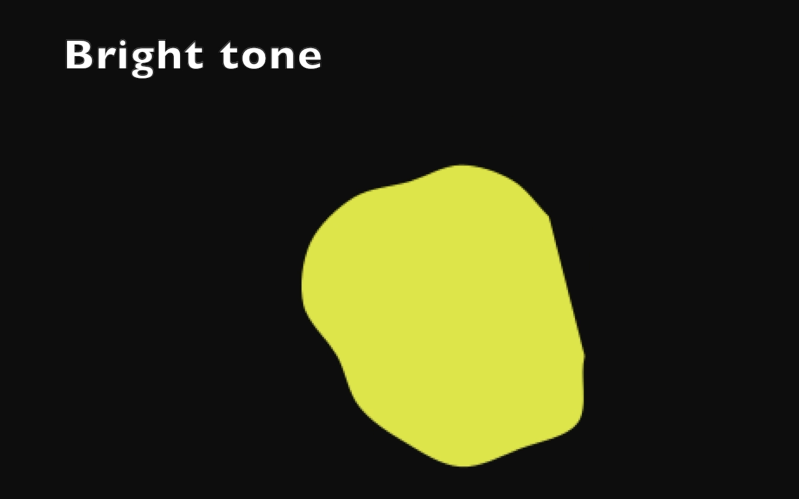
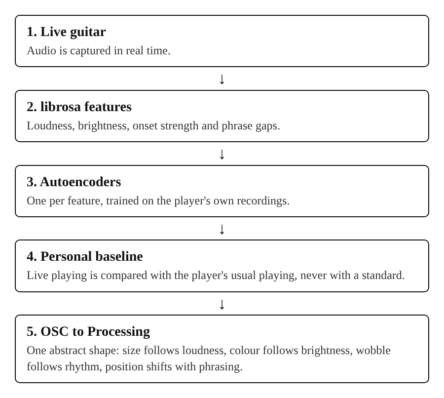
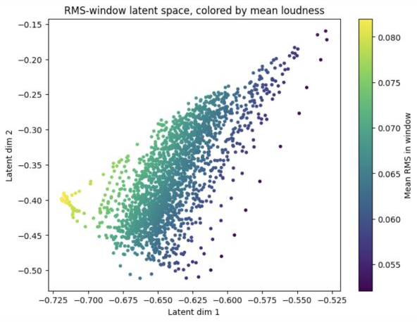
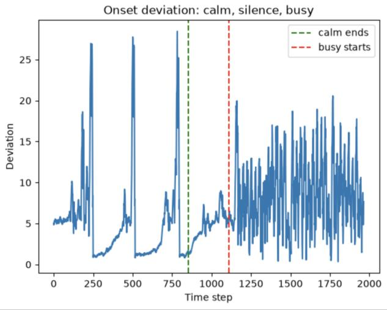

# A Non-Evaluative Machine Learning System for Supporting Musical Practice

**A real-time practice system for guitarists that never scores or grades.** It compares a musician's live playing to a personal baseline learned from their own recordings, with no external standard, and reflects the result back as a live abstract visual.

  

This is the code for my MSc Applied Machine Learning for Creatives thesis, *"A Non-Evaluative Machine Learning System for Supporting Musical Practice"* (UAL Creative Computing Institute, 2026). The research was presented at NIME 2026.

## Demo

*Click the image to watch the demo on YouTube. The shape grows with loudness, changes colour with brighter or darker tone, wobbles with rhythmic activity and shifts position when phrasing changes.*

## Why this exists

Music performance anxiety affects most musicians, and feedback that judges playing can make it worse. Most practice tools rate you against a standard. This project asks a different question:

> How can interactive music systems support reflective musical practice using machine learning without introducing evaluative feedback?

The system never labels playing as good or bad. It only shows how the current moment differs from your own usual playing, so the musician decides what to take from it.

## How it works

  

1. **Live guitar audio** is captured from a microphone or audio interface.
2. **Four features** are extracted with librosa: loudness (RMS), brightness (spectral centroid), rhythmic activity (onset strength) and phrase continuity (inter-onset intervals).
3. **RMS, centroid and onset** each pass through their own small autoencoder, trained on the musician's own recordings. Phrase continuity doesn't use an autoencoder.
4. **Each result is compared** with the musician's personal baseline. RMS is sent as a raw value.
5. **The values are sent by OSC** to a Processing sketch, which draws a single shape that changes size, colour, wobble and position.

### What each feature controls

| Feature | Measured with | Compared with baseline? | Shape |
|---------|---------------|-------------------------|-------|
| Loudness | RMS | No, raw value | Size |
| Brightness | Spectral centroid | Yes, via autoencoder | Colour |
| Rhythmic activity | Onset strength | Yes, via autoencoder | Wobble of the outline |
| Phrase continuity | Spread of inter-onset intervals | Yes, against average | Position shift |

### The personal baseline

Each of the musician's recordings is split into rolling windows and passed through the matching trained autoencoder. The average of all the resulting two-dimensional points is the baseline: one position per feature that represents their usual playing. In real time, the last 20 readings of each feature are encoded the same way and compared with it. The baseline is retrained from the stored recordings, ideally every three to five sessions. Every session is kept in full, with no filtering, so the musician never has to decide which playing was "good enough" to count.

   
  <em>An autoencoder trained on loudness: quiet and loud playing separate along a clear gradient in its two-dimensional latent space.</em>

## Design decisions

- **Unsupervised on purpose.** Supervised models need someone to label playing as "good" or "correct", which would defeat the non-evaluative idea. Autoencoders learn only from the player's own recordings.
- **One autoencoder per feature.** An autoencoder trained on all features at once was pulled towards the dominant feature and collapsed towards a single dimension.
- **Abstract shape, no numbers.** No grades, summaries or scores. One shape is easier to follow while playing than several, so the final system uses one.
- **Loudness stays raw.** Comparing loudness with a baseline made the shape grow when the player played *more quietly than usual*, which felt unintuitive.

## Evaluation under constraints

To check the system responds to real changes, a new baseline was trained on ten recordings of slow, sustained notes. Fast, sharp notes were then played. Median onset deviation was **4.5 for calm playing and 8.2 for busy playing**, and the shape's wobble matched: brief on single note attacks when calm, constant when busy.

   
  <em>Onset deviation from the baseline over time, from calm to silence to busy playing.</em>

## Setup

**Requirements**

- Python 3.11
- [Processing](https://processing.org/) with the `oscP5` library
- Python packages: `torch`, `librosa`, `numpy`, `sounddevice`, `python-osc`, `scikit-learn`, `matplotlib`

**Run it**

1. Open `live_processing_visualisation/` in Processing and press Run. The sketch listens for OSC messages on port 9000.
2. Open `live-integration.ipynb` and run the cells in order. They load the trained autoencoders from `models/`, start the microphone stream, and send live features to Processing while you play.

## Repository

| Path | Contents |
|------|----------|
| `live-integration.ipynb` | Main live pipeline: microphone, models, OSC |
| `live_processing_visualisation/` | Processing sketch: OSC receiver and visual |
| `models/` | Trained autoencoder weights (`.pt`) |
| `notebooks/` | Feature extraction, training and analysis |

## References

- McFee, B. et al. (2015). *librosa: Audio and music signal analysis in Python.* Proceedings of the 14th Python in Science Conference.

## Author

Daria Cotocu · [dariacotocu.com](https://dariacotocu.com)
